<p align="center">
  <picture>
    <source media="(prefers-color-scheme: dark)" srcset="frontend/public/brand/flo-wordmark-blush.png">
    
  </picture>
</p>

<h1 align="center">Flo-Wing Operations Dashboard</h1>

<p align="center">
  One screen for the owner and the CRM team: how many orders came in, where open orders are waiting,
  <b>who must act</b>, which payments need a call, what customers asked about and what came back.<br>
  Reads Flo-Wing's Google Sheets every minute. Read-only. Web app + Android/iPhone app + a built-in chatbot.
</p>

<p align="center">
  
  
  
  
  
</p>

<p align="center">
  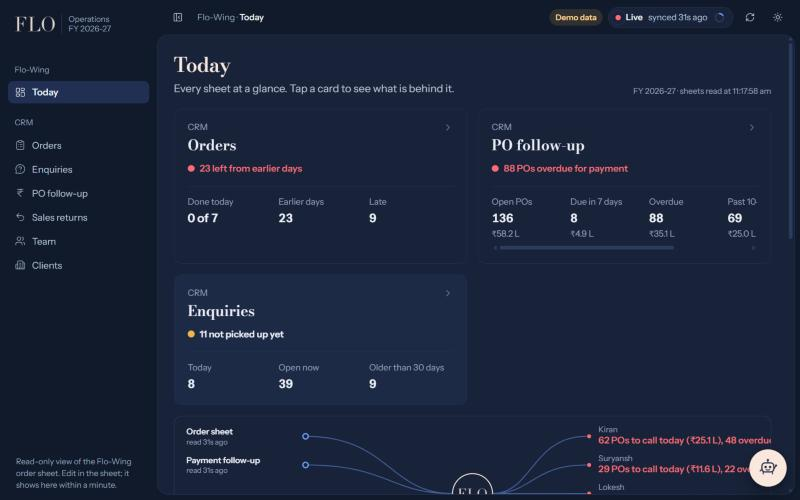
</p>

> Screenshots are taken on the built-in **demo data** (made-up clients and figures). With the Google key set, the same
> pages show the real sheets.

---

## Contents

1. [What it does](#what-it-does)
2. [Screens](#screens)
3. [How it works](#how-it-works)
4. [Flo-Wing Assistant (chatbot)](#flo-wing-assistant-chatbot)
5. [Deploy on Vercel](#deploy-on-vercel)
6. [Run locally](#run-locally)
7. [Settings (environment variables)](#settings-environment-variables)
8. [The sheets and the rules](#the-sheets-and-the-rules)
9. [Phone app](#phone-app)
10. [Tests](#tests)
11. [Project layout](#project-layout)

---

## What it does

| Page | Sheet it reads | What it answers |
|---|---|---|
| **Today** | all of them | Orders today / this month, open, late. PO follow-up and enquiry cards. *Needs action*: one line per person who must act, worst first. |
| **Orders** | NEW ORDERSHEET 2026-27 | Are today's orders done, and what is holding the rest: Mona's reply → PO → Billing, plus on hold. Every cause opens the orders behind it. |
| **PO follow-up** | CRM "New po sheet" (PO LOG) | How long each open PO has waited (0-4, 5-7, 8-10, 11+ days, PO not sent), the calling team's work for today, escalation L1/L2/L3, a WhatsApp **Send** to everyone. |
| **Enquiries** | ENQUIRY SHEET 2025-26 | Customer-care cases: enquired today, total open, not picked up yet, older than 30 days, grouped by category. |
| **Sales returns** | SALES RETURN (Quality Check Sheet) | Pieces returned, QC pass / fail, calls still to be made, returns outside the 90-day policy, by month, client and reason. |
| **Team** | Order sheet | Who is holding orders (Mona, PO team, Billing team), the sales team's orders, sets, clients and days to bill, rows someone forgot to complete. |
| **Clients** | Order sheet | Biggest clients, repeat buyers, who has gone quiet. |
| **Assistant** | every page | Ask anything in English or Hinglish: *"Kiran ke paas kitne pending hai"*, *"top 5 clients by orders"*, *"GR kya hai"*. |

Nothing is ever written to the order, payment, enquiry or returns sheets. The only sheet the dashboard writes to is the
optional **nudges** sheet (WhatsApp reminders that Iris sends).

---

## Screens

<table>
  <tr>
    <td width="50%">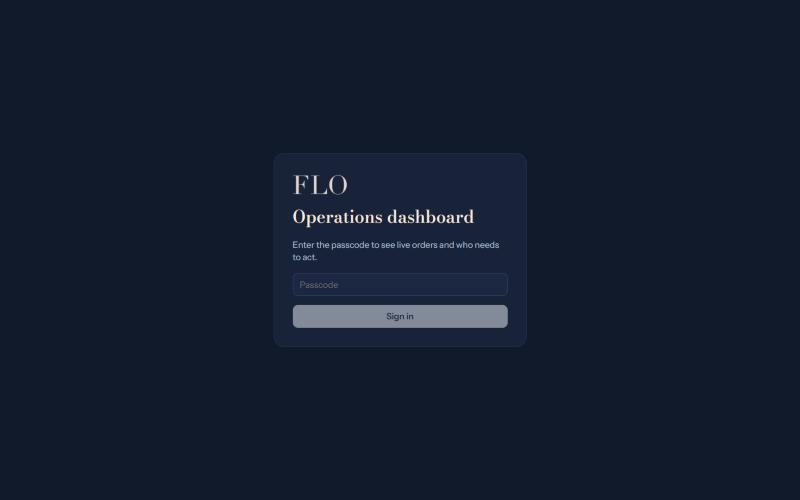<br><b>1. Password</b>: asked when the app opens, and again every 24 hours.</td>
    <td width="50%"><br><b>2. Preloader</b>: plays right after sign-in while the sheets load.</td>
  </tr>
  <tr>
    <td><br><b>Today</b>: every sheet at a glance, and who needs to act.</td>
    <td>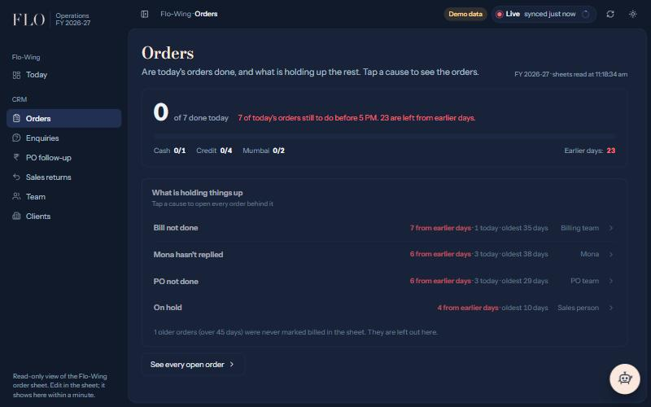<br><b>Orders</b>: today's orders and what is holding up the rest.</td>
  </tr>
  <tr>
    <td>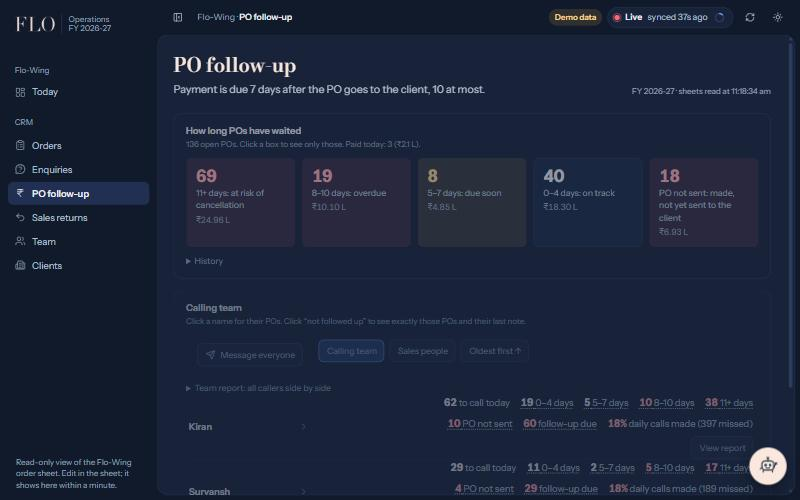<br><b>PO follow-up</b>: how long POs have waited, and the calling team.</td>
    <td>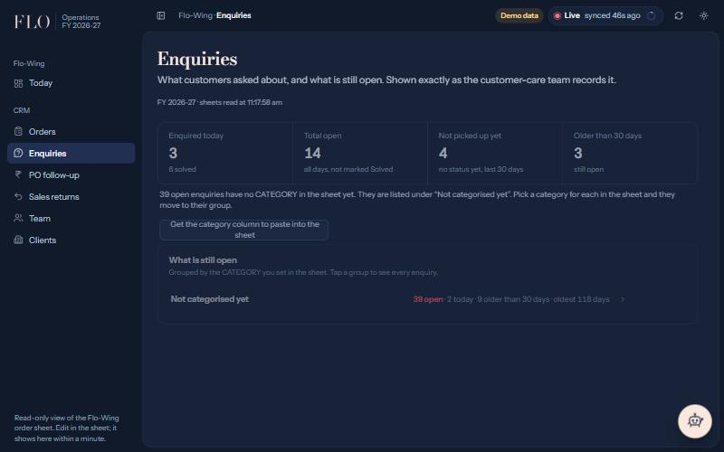<br><b>Enquiries</b>: what customers asked about, and what is still open.</td>
  </tr>
  <tr>
    <td>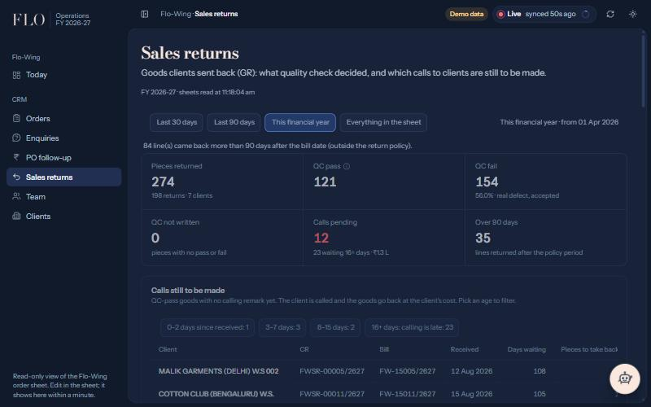<br><b>Sales returns</b>: QC pass / fail and calls still to be made.</td>
    <td>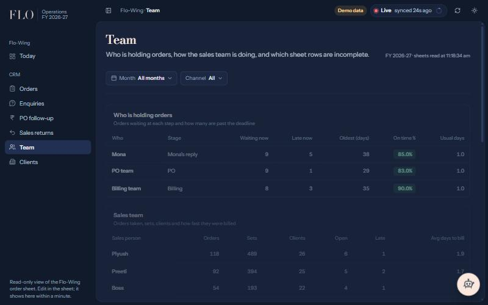<br><b>Team</b>: who is holding orders, and the sales team.</td>
  </tr>
  <tr>
    <td>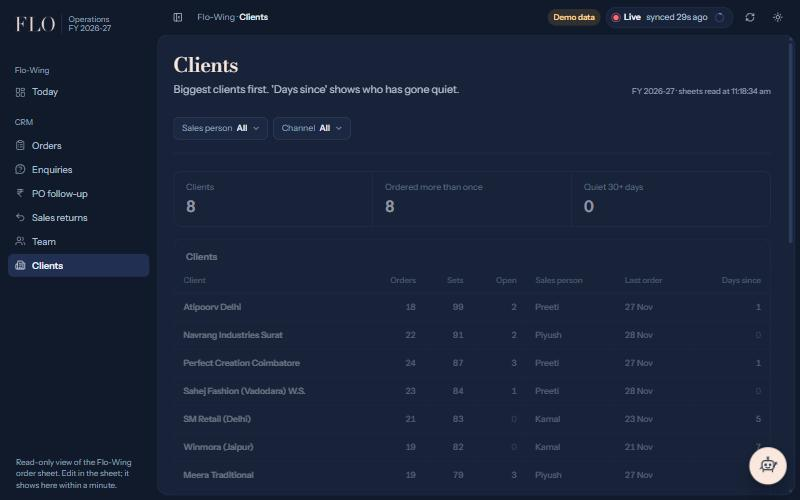<br><b>Clients</b>: biggest clients first, and who has gone quiet.</td>
    <td>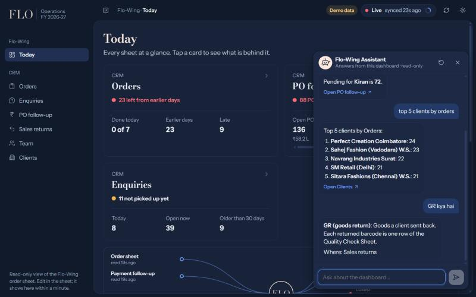<br><b>Flo-Wing Assistant</b>: answers from the dashboard's own numbers.</td>
  </tr>
</table>

---

## How it works

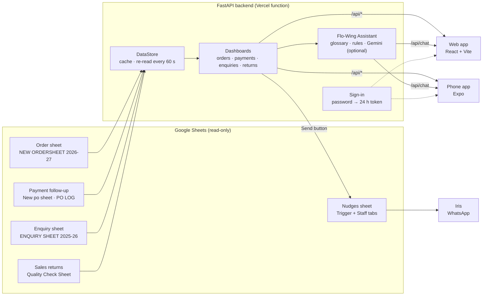

- **One domain on Vercel.** `vercel.json` runs two services: `/api/*` goes to the FastAPI backend, every other path goes to the React app.
- **Sheets are read by heading, never by column letter** (`backend/app/locate.py`), so inserted columns, renamed headings and
  messy rows don't break the numbers. A tab that loses a needed heading is left out with a warning on Today.
- **Every page and the chatbot use the same functions**, so a figure in the chat is always the figure on screen.

### Sign-in flow

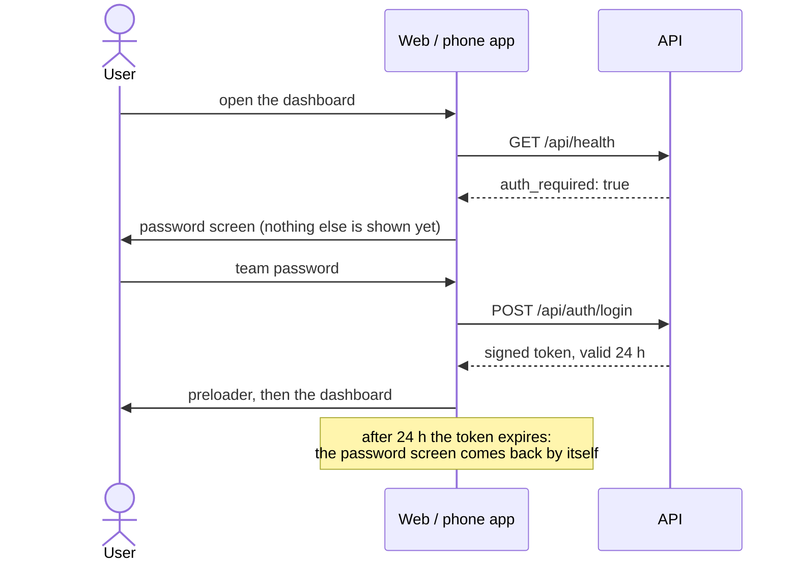

The password lives only in the server settings (`DASHBOARD_PASSCODE`), never in the web or phone code. Tokens are signed with
`TOKEN_SECRET` and last `TOKEN_HOURS` (24).

### The order pipeline

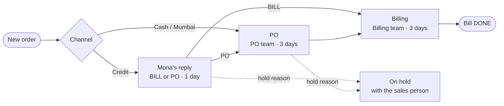

An order is **late** when it has waited at its step longer than that step allows (counted from the order date). Owners and
deadlines are in one place: `STAGES` in `backend/app/dashboards/orders.py`.

### PO follow-up timeline

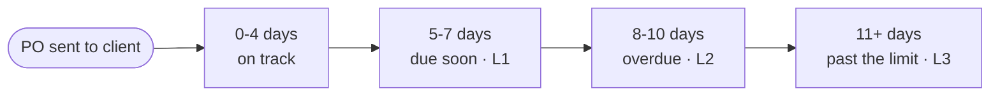

L1: the caller reminds the client. L2: the sales person and Kavita are told. L3: cancel or collect, decision with Kavita.
Rules live in `backend/app/dashboards/payments.py` (`DUE_DAYS`, `LIMIT_DAYS`, `ESC_LEVELS`).

---

## Flo-Wing Assistant (chatbot)

The robot button in the bottom-right corner of every page (and a screen in the phone app). It reads the dashboard's own
figures each time, so it always has today's numbers, and it never writes anything.

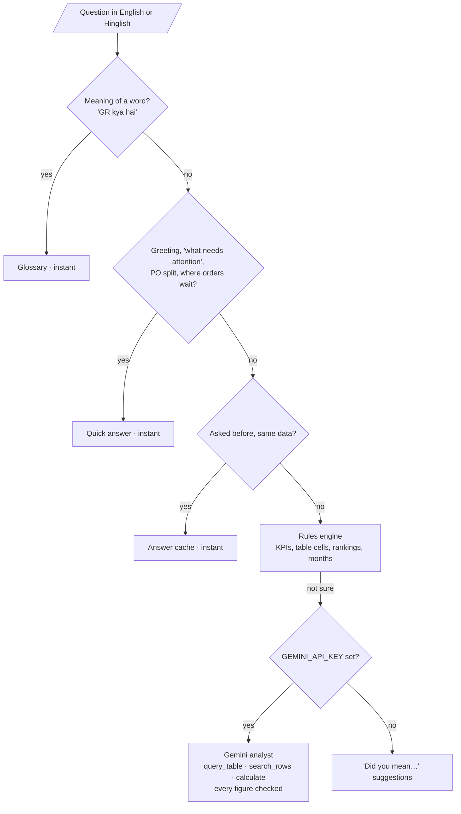

| Ask | It answers from |
|---|---|
| *Kitne orders late hai?* · *Orders this month* · *open orders* | Today |
| *late orders of Piyush* · *Credit channel open orders* · *orders in October* | Orders (with filters) |
| *Mona ke paas kitne waiting hai* · *which sales person has the most late orders?* | Team |
| *pending payments* · *Kiran ke paas kitne pending hai* · *L3 escalation kitne hai* | PO follow-up |
| *total open enquiries* · *enquiries not picked up yet* | Enquiries |
| *pieces returned* · *top client by returns* · *QC pass kitne hai* | Sales returns |
| *top 5 clients by orders* · *Atipoorv Delhi orders* | Clients |
| *GR kya hai* · *QC fail ka matlab* · *escalation ka matlab* | Glossary (`backend/app/assistant/glossary.py`) |

Without a Gemini key it uses the glossary, quick answers and rules only (free, instant). With `GEMINI_API_KEY` it also does
calculations, look-ups of particular rows ("details of FWSO-08501", "oldest open enquiry") and follow-ups, using exact data
tools over every row (`backend/app/assistant/datatools.py`). Teaching it a new word: add a `Term` to `glossary.py`; a new way of
asking: `text.py` (`PHRASES`, `WORDS`) or `pages.py`.

---

## Deploy on Vercel

1. **Import the GitHub repo** in Vercel (`FLO-AI-DEV/flowing-dashboard`, branch `main`). Leave the root directory as the repo
   root: `vercel.json` defines both services.

   ```json
   {
     "services": {
       "frontend": { "root": "frontend", "framework": "vite", "buildCommand": "npm run build", "outputDirectory": "dist" },
       "backend":  { "root": "backend",  "framework": "fastapi", "entrypoint": "app.main:app" }
     },
     "rewrites": [
       { "source": "/api/(.*)", "destination": { "service": "backend" } },
       { "source": "/(.*)",     "destination": { "service": "frontend" } }
     ]
   }
   ```

2. **Settings → Environment Variables → Import .env** and pick `backend/.env` (kept on your PC, never committed). It holds
   every key listed [below](#settings-environment-variables).
3. **Deploy.** Open the site: the password screen comes first.
4. **Share each Google Sheet** with the service account's `client_email` as **Viewer** (and the nudges sheet as **Editor** if
   you use the Send buttons).
5. If the site address is not `https://flo-dashboardd.vercel.app`, change `EXPO_PUBLIC_API_URL` in `mobile/eas.json` before
   building the phone app.

`.vercelignore` keeps tests, docs, the phone app, `.env` files and key files out of the upload.

---

## Run locally

```bash
# API (demo data unless a Google key is set)
cd backend
python -m venv .venv && .venv\Scripts\activate          # macOS / Linux: . .venv/bin/activate
pip install -r requirements-dev.txt
cp .env.example .env                                     # or use your real backend/.env
uvicorn app.main:app --reload --port 8000

# Web (second terminal)
cd frontend
npm install
npm run dev                                              # http://localhost:5173 (calls the API on :8000)
```

One process instead of two: `npm run build` in `frontend`, then start the API with `SERVE_FRONTEND=1` and open
`http://localhost:8000`.

Check what the key can read:

```bash
cd backend
python scripts/check_access.py secrets/<key>.json   # which sheets the key can open
python scripts/check_data.py secrets/<key>.json     # what the dashboard reads from them, tab by tab
```

---

## Settings (environment variables)

All of these go in `backend/.env` locally and in Vercel's Environment Variables. `backend/.env.example` lists them with
comments.

| Setting | Example | Meaning |
|---|---|---|
| `DATA_SOURCE` | `google` | `google` reads the real sheets, `demo` uses built-in sample data. |
| `GOOGLE_SERVICE_ACCOUNT_JSON` | `'{"type":"service_account",…}'` | The read-only service-account key, whole JSON on one line. (Or `GOOGLE_SERVICE_ACCOUNT_FILE` with a path, locally.) |
| `DASHBOARD_PASSCODE` | *team password* | Turns on the password screen. |
| `TOKEN_SECRET` | *long random text* | Signs the sign-in tokens. Keep it secret; changing it signs everyone out. |
| `TOKEN_HOURS` | `24` | How long a sign-in lasts before the password is asked again. |
| `LIVE_TTL_SECONDS` | `60` | How often the sheets are re-read. |
| `TAB_TTL_SECONDS` | `600` | How often the list of tabs is re-read. |
| `REFRESH_COOLDOWN_SECONDS` | `15` | Minimum gap between two forced refreshes (↻ button). |
| `NUDGE_SHEET_ID` | *sheet id* | The nudges sheet (Trigger + Staff tabs). Empty = Send buttons hidden. |
| `NUDGE_DASHBOARD_URL` | `https://flo-dashboardd.vercel.app` | Link added at the end of each WhatsApp message. |
| `GEMINI_API_KEY` | *key* | Optional. Lets the assistant do calculations and row look-ups. |
| `GEMINI_MODEL` | `gemini-flash-lite-latest` | Any Gemini model; a *lite* one keeps it cheap. |
| `GEMINI_MODE` | `analyst` | `analyst` (sees figures, can look up rows) or `labels` (sees only label names). |
| `ANALYST_DEADLINE` | `20` | Seconds Gemini may take before the rules answer instead. |
| `WARM_UP` | `on` | Read every sheet at start-up so the first question is fast. |
| `CHAT_LOG` | `off` | `on` writes question text (no figures) to `backend/chat_questions.log`. Leave `off` on Vercel. |
| `CORS_ORIGINS` | *empty* | Extra browser origins allowed to call the API. Not needed on Vercel or for the phone app. |

---

## The sheets and the rules

**Order sheet.** One tab per month and channel (`NOV CREDIT SALE`, `NOV CASH SALE`, `Nov MUMBAI SALE`…). New month tabs are
picked up by name. Headings can sit anywhere in the top rows; spellings like `MONA REPLY` / `BILL/PO BY MONA` are both
understood; `3+6 pcs` counts as 9. This and last month's tabs are re-read every minute, older tabs every 6 hours.

| Stage | Owner | Deadline (days after order date) | Reason column shown |
|---|---|---|---|
| Mona's reply (BILL / PO), **Credit only** | Mona | 1 | HOLD REASON |
| PO (Credit when Mona said PO; **every Cash / Mumbai order**) | PO team | 3 | PO NOT DONE REASON |
| Billing (BILL STATUS = DONE) | Billing team | 3 | BILL NOT DONE REASON |

**Payment follow-up.** One row per sale order (FWSO-…). Pending = PAYMENT STATUS blank. *Not followed up* = no follow-up note
for 2+ days, measured from the form's time stamps. A note pasted on 10+ rows with the same time stamp is ignored as a bulk
paste. Only the rows of the chosen window (30 / 60 / 90 days) are read from the long PO log.

**Enquiries.** Three tabs: *daily enquiry update*, *BILL T LOGISTIC ENQUIRY*, *PARTY BILLING ISSUE*. An enquiry is solved only
when the sheet says so; everything else is open.

**Sales returns.** One row per returned barcode. QC FAIL = real defect, accepted. QC Pass = goods are fine, the client is called
and the goods go back. Returns are accepted only within **90 days** of the bill date.

---

## Phone app

`mobile/` is an Expo (React Native) app that calls the same API and has the same assistant screen. It signs in with the same
password and asks again after 24 hours. Expo project: **flo-wings-team / flowing**.

```bash
cd mobile
npm install
npx expo start                                                  # try it in Expo Go
npx eas-cli@latest build --profile preview --platform android   # installable APK + QR code on expo.dev
```

> The phone screens are still the earlier FLO layout. Adapting them to the Flo-Wing pages (Today, Orders, PO follow-up,
> Enquiries, Sales returns) is the next phase; see [CHECKPOINT.md](CHECKPOINT.md).

---

## Tests

```bash
cd backend && pytest              # API, sheet reading, rules, nudges, assistant (90 tests)
cd frontend && npm test           # UI units
cd frontend && npm run build      # typecheck + production build
cd mobile && npm run typecheck && npm test
```

The backend tests always run on demo data, even when a real `backend/.env` is present (`tests/conftest.py`).

---

## Project layout

```
backend/                 FastAPI API (Vercel service "backend")
  app/main.py            every endpoint, sign-in, chat
  app/dashboards/        orders · payments (PO follow-up) · enquiries · returns
  app/assistant/         chatbot: engine, glossary, pages, datatools, Gemini analyst
  app/locate.py          finds columns by heading in messy sheets
  app/store.py           cached sheet reads (60 s)
  app/nudges.py          WhatsApp reminders through the nudges sheet
  scripts/               check_access / check_data with a real key
  tests/                 pytest, demo data
frontend/                React + Vite web app (Vercel service "frontend")
  src/pages/             Home (Today) · Orders · Payments (PO follow-up) · Enquiries · Returns · Team · Clients
  src/components/        shell, tables, charts, preloader, assistant
mobile/                  Expo phone app
docs/screenshots/        images used in this README
vercel.json              two services, one domain
```
